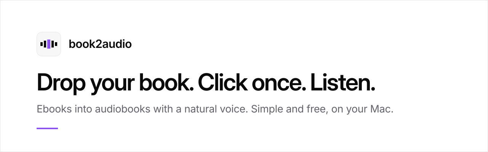
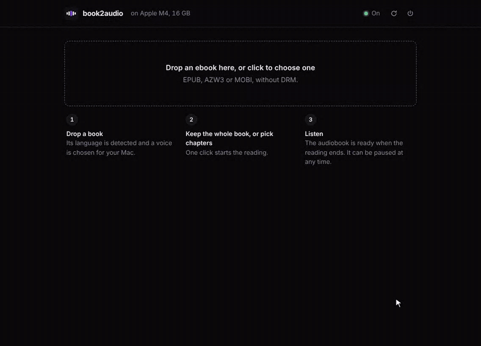

<p align="center">
  <picture>
    <source media="(prefers-color-scheme: dark)" srcset="assets/banner-dark.png">
    
  </picture>
</p>

book2audio turns an ebook into an audiobook on your Mac. It detects the book's language and picks the most natural voice your Mac can run. Free and open source. Nothing leaves your Mac.

<p align="center"></p>
<p align="center"><sub>Demo with a test book, sped up. A real book takes from about a third of its listening time to longer than it, depending on your Mac.</sub></p>

> [!IMPORTANT]
> **This tool is intended for use with non-DRM, legally acquired eBooks only.**
> The authors are not responsible for any misuse of this software or any resulting legal consequences.
> Use this tool responsibly and in accordance with all applicable laws.

## Install

On a Mac with Apple Silicon (M1 or later), paste this in the Terminal:

```bash
curl -LsSf https://raw.githubusercontent.com/alexandre-darmon/book2audio/main/install.sh | sh
```

It takes a few minutes the first time, then opens book2audio in your browser. Run the same command again to update.

Next time, open **book2audio** from the Applications folder inside your home folder.

## Use

1. Drop your book: EPUB, AZW3 or MOBI, without DRM.
2. Keep the whole book, or untick chapters.
3. Click **Create the audiobook** and wait for the reading to end.

The audiobook is one `.m4b` file with chapters and the book's cover, in `~/Audiobooks`. Reading can be paused and resumed at any time, even after a restart.

## On your iPhone

Leave "Also send it to my iPhone (iCloud Drive)" ticked. The audiobook appears in the Files app, under iCloud Drive, Audiobooks. Open it in an audiobook player such as BookPlayer, which keeps your position.

## Good to know

- **Languages.** French and English are the ones tested. Nine others are offered: Spanish, German, Italian, Portuguese, Dutch, Hindi, Arabic, Japanese and Chinese.
- **Speed.** On a MacBook Pro M6 with 32 GB, a French book is created 2.7 times faster than it is listened to. On a MacBook Pro M1 with 8 GB, it takes longer than listening: let it run overnight.
- **Voices.** Click "Change" to hear each voice and pick another one, or to record your own (experimental).
- **Interface.** In French when your browser is in French, in English otherwise.
- **Licences.** The code is MIT. The default voice model, Voxtral, is for non-commercial use (CC BY-NC 4.0).

Voices, models, measured speeds, reading rules and the command line are in the [guide](docs/guide.md). What comes next is in the [roadmap](ROADMAP.md).

## Limits

- Books bought on Amazon or Apple are DRM-protected and cannot be read.
- Chapters come from the book's table of contents. A book that puts everything in one file gives one long chapter.
- Footnote numbers and tables are skipped.

## Remove

`uv tool uninstall book2audio`, then delete `~/Applications/book2audio.app`. Your audiobooks stay in `~/Audiobooks`.
